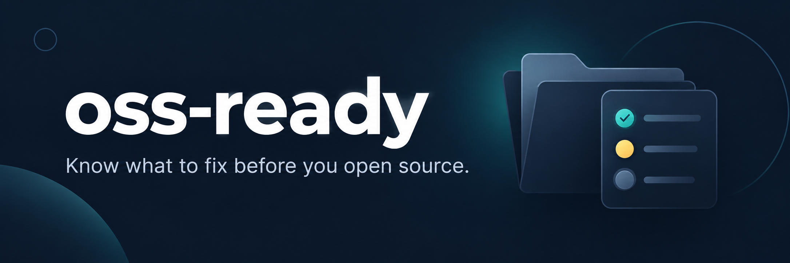

<p align="center">
  
</p>

<p align="center"><a href="README.md"><b>English</b></a> · <b>한국어</b></p>

<h2 align="center">저장소를 공개하기 전에, 빠진 것부터 확인하세요.</h2>

<p align="center">
  내 컴퓨터와 SSH 서버의 Git 저장소를 한 번에 점검합니다.<br>
  소스 코드를 업로드하지 않고, 메타데이터로 점검 목록과 우선순위를 만듭니다.
</p>

<p align="center">
  <a href="https://github.com/kks0488/oss-ready/actions/workflows/ci.yml"></a>
  
  
  <a href="LICENSE"></a>
</p>

<table>
<tr>
<td width="50%" valign="top">

### 빠진 준비물을 찾습니다
README, 라이선스 파일, 테스트 폴더, GitHub Actions, 기여·행동·보안 안내를 확인합니다. 점수와 검토할 항목을 보여 줍니다.

</td>
<td width="50%" valign="top">

### 소스 코드는 그대로 둡니다
Git 메타데이터, 폴더 이름, 추적 중인 파일 이름을 살펴봅니다. 저장소의 전체 경로는 요청한 경우에만 표시합니다.

</td>
</tr>
<tr>
<td width="50%" valign="top">

### 흩어진 저장소를 모아 봅니다
여러 로컬 폴더와 SSH 서버를 한 번에 점검합니다. GitHub 원본이 같은 복사본은 결과 하나로 합칩니다.

</td>
<td width="50%" valign="top">

### GitHub 정보도 더할 수 있습니다
원하면 스타, 포크, 릴리스, 기여자와 권한이 있는 방문·복제 통계를 가져옵니다. 결과는 Markdown이나 JSON으로 저장합니다.

</td>
</tr>
</table>

## 빠른 시작

**Python 3.10 이상**과 **Git**이 필요합니다. 별도 Python 실행 의존성은 없습니다. GitHub 정보를 가져오려면 로그인된 [GitHub CLI](https://cli.github.com/)가, SSH 점검에는 `ssh`와 원격 서버의 Python 3·Git이 필요합니다.

```bash
git clone https://github.com/kks0488/oss-ready.git
cd oss-ready
python3 -m venv .venv
source .venv/bin/activate
python -m pip install .

# 이 저장소 점검
oss-ready --root .

# 여러 저장소가 들어 있는 폴더 점검
oss-ready --root ~/projects --output reports/readiness.md
```

Windows에서는 `.venv\Scripts\activate`로 가상환경을 켭니다. Windows에서의 동작은 아직 검증하지 않았습니다.

## 실제 터미널 출력

**2026-10-16**에 아래 공개 저장소를 직접 복제해 실행했습니다. 얕은 복제본을 사용했고, GitHub 정보 조회 없이 나온 실제 출력의 일부입니다.

```bash
mkdir samples
git clone --depth 1 https://github.com/pallets/click.git samples/click
git clone --depth 1 https://github.com/psf/requests.git samples/requests
oss-ready --root samples
```

```text
| Score | Verdict | Repository | Stars | 14d unique clones | License | Tests | CI |
|---:|:---:|---|---:|---:|:---:|:---:|:---:|
| 51 | PREP | pallets/click | 0 | - | yes | yes | yes |
| 21 | HOLD | psf/requests | 0 | - | yes | yes | yes |
```

점검한 커밋은 Click `2247b35`, Requests `611c616`입니다. Requests의 `tests/certs/valid/server/server.key` 같은 테스트 인증서 이름이 비밀 파일 패턴에 해당해 `HOLD`로 나왔습니다. 파일 내용을 읽어 실제 비밀인지 판단하지는 않습니다. `--github`가 없으면 스타는 `0`, GitHub 상태와 방문·복제 통계는 미확인으로 남습니다. 커밋과 시간에 따라 점수는 달라질 수 있습니다.

## 다른 사용법

```bash
# 기존 gh 로그인으로 GitHub 정보 조회
oss-ready --root ~/projects --github --owner YOUR_GITHUB_NAME

# 로컬과 SSH 폴더를 함께 점검. 같은 옵션을 여러 번 쓸 수 있습니다.
oss-ready --root ~/projects --ssh dev:/srv/projects --max-depth 3

# 다른 도구에서 활용할 JSON 저장
oss-ready --root ~/projects --format json --output reports/readiness.json

# 개인용 보고서에 저장소 전체 경로 표시
oss-ready --root ~/projects --show-paths
```

SSH는 비밀번호를 묻지 않는 방식(`BatchMode=yes`)으로 접속합니다. 키와 서버 접속을 먼저 설정하세요. 원격 서버에서 수집 코드를 실행해 메타데이터와 파일 이름만 받아오며, 소스 내용은 전송하지 않습니다. 전체 옵션은 `--help`로 확인할 수 있습니다.

## 결과 읽는 법

| 결과 | 의미 |
| --- | --- |
| `READY` | 70점 이상, README·라이선스 파일이 있고 파일명·포크·보관 상태에 따른 보류 사유가 없음. |
| `PREP` | 45점 이상이며 파일명·포크·보관 상태에 따른 보류 사유가 없음. 빠진 항목을 검토할 단계. |
| `HOLD` | 점수가 낮거나, 비밀처럼 보이는 추적 파일명·포크·보관 상태로 검토가 필요함. |

점수는 최대 100점입니다. 문서, 활동, 커뮤니티 안내와 선택적으로 가져오는 GitHub 활용 지표를 반영합니다. `--owner`는 다른 소유자를 검토 항목으로 표시하지만 `READY`를 막지는 않습니다. 파일 존재 여부를 확인할 뿐 라이선스 조건을 해석하거나 테스트를 실행하거나 CI 성공 여부를 검증하지 않습니다. 테스트는 최상위 `test/`·`tests/`, CI는 `.github/workflows/` 폴더로 판단합니다.

이 점수는 검토 순서를 정하는 참고 자료입니다. 소스 내용, Git 이력의 비밀, 개인정보, 저작권 출처는 검사하지 않으며 저장소 공개 설정도 바꾸지 않습니다. 공개 전에는 별도의 이력 검사 도구와 코드 검토가 필요합니다.

## 자주 묻는 질문

**코드를 업로드하나요?** 아니요. 로컬 점검은 내 컴퓨터에서 끝납니다. SSH는 수집 코드를 보내고 메타데이터와 파일 이름을 받습니다. `--github`는 저장소 이름과 기존 인증 정보로 `gh`를 통해 GitHub API를 호출합니다. 보고서에는 저장소·호스트·파일 이름이 드러날 수 있으니 공유 전에 확인하세요.

**비밀 탐지 도구인가요?** `.env`, 개인 키 이름, 인증 정보 JSON 같은 추적 파일명을 표시합니다. `.example`, `.sample`, `.template`, `.dist`로 끝나는 파일은 제외합니다. 내용을 읽지 않아 테스트 파일도 걸릴 수 있고, 평범한 이름의 파일에 들어 있는 비밀은 놓칠 수 있습니다.

**통계가 왜 비어 있나요?** GitHub 방문·복제 통계는 해당 저장소의 조회 권한이 필요합니다. 조회하지 못한 통계는 미확인으로 남습니다. 기여자와 릴리스는 각각 API 결과의 처음 100개까지만 집계합니다. 얕은 복제본에서는 커밋 수도 적게 나옵니다.

**URL을 바로 점검할 수 있나요?** 먼저 복제한 뒤 `--root`를 사용하세요. 일반 복제본과 Git worktree를 지원합니다. 저장소를 찾으면 그 아래는 더 탐색하지 않으며, 일반적인 의존성·빌드·캐시·숨김 폴더도 건너뜁니다. Bare 저장소는 찾지 않습니다.

**종료 코드로 공개를 막을 수 있나요?** `HOLD`가 있어도 점검이 끝나면 `0`을 반환합니다. 잘못된 인자나 점검·저장 실패는 `2`입니다. 자동 기준이 필요하면 JSON의 판정을 확인하세요.

## 개발

```bash
python -m pip install .
python -m unittest discover -s tests -v
```

GitHub Actions는 Python 3.10·3.12·3.14에서 패키지를 설치하고 테스트와 설치된 CLI 실행을 확인합니다. SSH 명령의 경로 처리는 로컬 셸로 검증했습니다. 실제 SSH 서버와 Windows에서는 아직 검증하지 않았습니다.

<p align="center">
  <a href="CONTRIBUTING.md">기여 안내</a> · <a href="SECURITY.md">보안</a> · <a href="CODE_OF_CONDUCT.md">행동 강령</a><br>
  <a href="LICENSE">MIT</a> © kks0488
</p>
